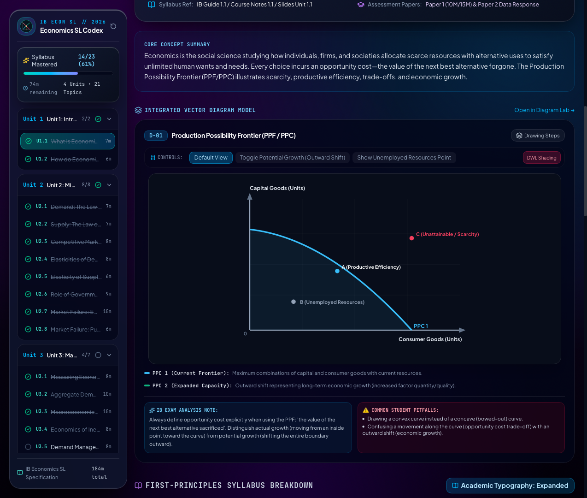
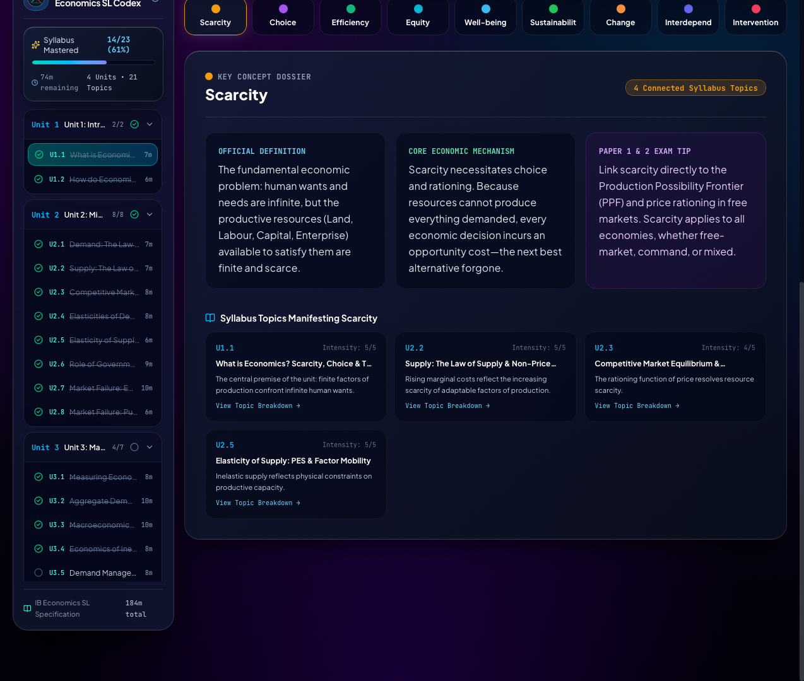
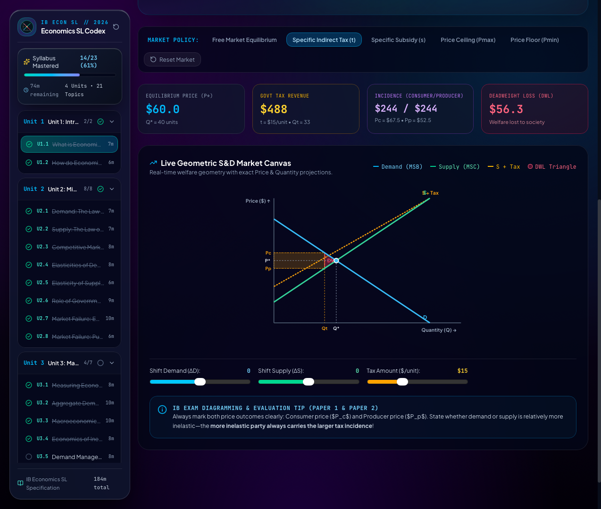
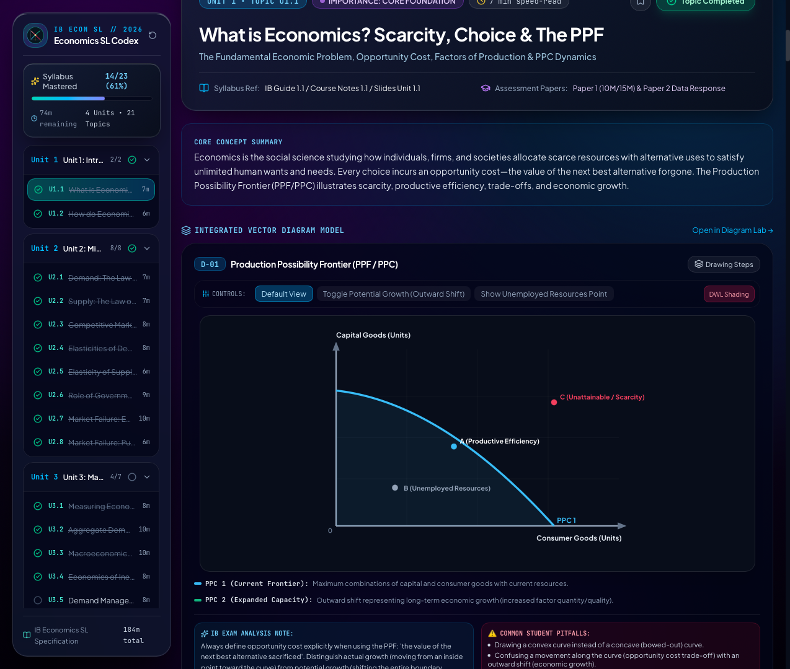
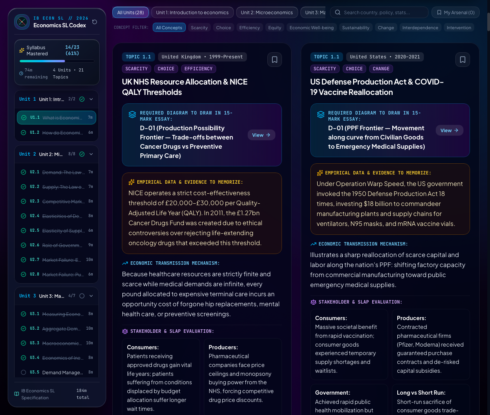

⚖️ Equilibrium // IB Economics SL
The IB Economics Study Dashboard for macOS

Equilibrium is a native macOS application built for International Baccalaureate (IB) Diploma Economics students (SL & HL). It combines comprehensive 2022–2026 syllabus analysis, interactive economic diagrams, quantitative policy tools, and real-world macroeconomic case studies with a teal Liquid Glass bento interface, active recall flashcards, and live desktop widgets.

---

📸 Interface Preview & Navigation

1. The Command Center (Hero Overview)

The primary launchpad provides a high-level view of your syllabus progress and current economic modeling target:
* Economic Mastery Tracker: Tracks syllabus completion across Unit 1 (Introduction to Economics), Unit 2 (Microeconomics), Unit 3 (Macroeconomics), and Unit 4 (The Global Economy) in real time.
* Syllabus Unit Navigation: Direct access to all syllabus sections with difficulty tags, reading telemetry, and completed topic checks.
* Economic Model Bento: Breaks down key theoretical assumptions, real-world policy applications (e.g. sugar taxes, minimum wage, central bank interest rates), and evaluation criteria.
* Global Spotlight Search: Press `⌘K` to search across all syllabus concepts, formulas, diagram models, and economic theorists.

---

2. Analytical Hub & Economic Diagram Matrix

Designed specifically for IB Paper 1 (Extended Response), Paper 2 (Data Response), and Internal Assessment (IA) portfolio commentary:
* Diagrammatic Modeling Bank: Complete visual breakdowns of PPC, Supply & Demand, Market Failure Externalities (Negative Consumption/Production), AD/AS (Classical vs. Keynesian), Phillips Curve, Lorenz Curve, and Tariff/Trade Protectionism.
* Policy Evaluation Frameworks: High-scoring evaluation points (Stakeholders, Efficiency vs. Equity, Short-run vs. Long-run, Government Failure).
* Real-World Examples Bank: Pre-curated contemporary case studies across global economies for Paper 1 Part (b) essays.

---

3. Active Revision Modes

* Continuous Flow Syllabus Stream: Read uninterrupted syllabus overviews, diagram explanations, and examiner tips in a smooth, vertical reading stream.

* Active Recall Flashcards: Test memory retrieval on elasticity definitions (PED, PES, YED), monetary & fiscal policies, and exchange rate mechanisms.
* Pomodoro Focus Timer: Integrated 25-minute study intervals with audio chime and status tracking.

---

4. Theorists & Economics Glossary Dossier

* Economic Theorists Bank: In-depth breakdowns of Adam Smith, John Maynard Keynes, Milton Friedman, Friedrich Hayek, Arthur Pigou, and Elinor Ostrom.
* 9 Key Concepts: Scarcity, Choice, Efficiency, Equity, Economic Well-Being, Sustainability, Change, Interdependence, and Intervention.

---

5. Desktop Widgets (macOS WidgetKit)
Keep revision top-of-mind without keeping the full app open:
* Live Equilibrium Counter: Displays active study streak, remaining syllabus topics, and current model on your macOS desktop or Notification Center.
* Multi-Size Liquid Glass Templates: Available in Small, Medium, and Large dossier view.
* Local Offline Sync: Synchronizes instantly across macOS without requiring an account login or cloud database.

---

⌨️ Keyboard Shortcuts

* `⌘ + K`: Open quick Spotlight search for economic concepts, models, and theorists
* `⌘ + B`: Toggle sidebar navigation drawer
* `⌘ + I`: Toggle Pro Analytical Inspector
* `⌘ + E`: Launch Timed Exam Sprint mode
* `1`: Switch to Single Topic Bento view
* `2`: Switch to Continuous Flow stream view
* `3`: Switch to Active Recall & Cram hub
* `4`: Switch to Diagram & Concept Matrix view
* `5`: Switch to Theorists & Glossary dossier

---

🛠️ Technical Highlights

* Modern Web Core: Built using Next.js 16, React 19, and Tailwind CSS.
* Native macOS Shell: Runs inside an Apple AppKit and WKWebView container with smooth 120 FPS animations.
* On-Device Storage: Local state management persists notes and progress directly on your Mac via Zustand.
* Zero Dependencies: Fully self-contained local build requiring no external cloud databases.

---

🎓 IB CAS Alignment

* Creativity: Engineering an elegant, native macOS study dashboard featuring a teal Liquid Glass visual identity, interactive economic graphs, and native desktop widgets.
* Service: Publishing open-source software to empower secondary school economics students globally with accessible, distraction-free study resources.

---

🛠️ macOS Installation Instructions

Because this is a free, open-source app, macOS Gatekeeper may block it from opening initially because it hasn't been signed by a paid Apple Developer account. 

Here is how to safely install and open it:

1. Download the latest `IBEconomicsCodex-macOS-v1.0.dmg` file from the Releases page and double-click to open it.
2. Drag the **IB Economics SL** app into your **Applications** folder.
3. Try to open the app by double-clicking it. You will see a warning that it cannot be opened. Click **Done** or **OK**.
4. Open your Mac's **System Settings** and navigate to **Privacy & Security**.
5. Scroll down to the **Security** section. You will see a message stating the app was blocked to protect your Mac.
6. Click the **Open Anyway** button next to that message.
7. Enter your Mac password or use Touch ID, then click **Open** on the final popup.

*Note: You only need to do this the very first time. Afterward, you can open the app normally from your Launchpad or Spotlight.*
